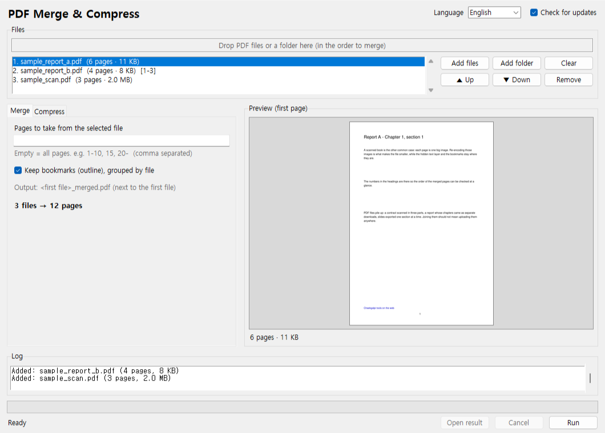

# Chaekgalpi Tools – PDF Merge & Compress

[한국어](README.md) · [中文](README.zh-CN.md) · [日本語](README.ja.md)

Drop several PDFs to **merge** them into one, or re-encode their images to **compress** them. A Windows program that uploads nothing: contracts, medical records, scanned books - anything you would rather not hand to someone's server - stay on your PC. No server (except the update check, which can be turned off), no install, no page limit, the originals are never modified.



## Download

- **Executable**: grab `pdf-merge-split.exe` from [Releases](https://github.com/microhan1/pdf-merge-split/releases) and double-click it. Nothing to install. The exe is unsigned, so if SmartScreen warns, choose "More info → Run anyway".
- **Run from source**:

```bash
pip install -r requirements.txt
python main.py
```

## Usage

1. Drop PDF files or a folder onto the window, in the order to merge. Drag in the list, or use "▲ Up" / "▼ Down", to reorder.
2. Pick a tab.
   - **Merge**: each file can be limited to a page range (`1-10, 15, 20-`). Every file's bookmarks (outline) go in under an entry named after the file. Output: `<first file>_merged.pdf`.
   - **Compress**: choose the image quality (normal, small, minimum) and a resolution ceiling (300, 200, 150 dpi); an estimated size is shown. Only the images are re-encoded - text (search), bookmarks, links and page sizes stay as they are. Output: `<name>_small.pdf`.
3. Press **Run**. The result is written next to the original; an existing name gets `(2)`, `(3)`, and the original is never touched.


*The sample scan (3 pages, 2.0 MB) compressed with "normal, 200 dpi" (Korean screen). Numbers depend on the file.*

There is a command line too.

```bash
python main.py a.pdf b.pdf c.pdf --merge
python main.py a.pdf b.pdf --merge --pages 1-10 --pages all
python main.py scan.pdf --shrink --quality small --dpi 150
python main.py scans/ --shrink
```

`python main.py --help` prints the options in your OS language (한국어 · English · 中文 · 日本語).

## Sample files

`samples/` holds copyright-free PDFs to try (made by `samples/make_sample.py`): two text PDFs with bookmarks and links, and one 300 dpi scan-like PDF.

## Update check

On start the tool sends only its name (`pdfmerge`) and version to the Chaekgalpi server (chaekgalpi.co.kr) to learn whether a newer version exists. No file is sent, it asks once a day at most, and it can be turned off (the **Check for updates** box at the top of the window). The check runs in the background after the window opens; when there is no connection nothing is shown. Command-line runs never check.

When a newer version exists a one-line notice appears at the bottom of the window. **Update** opens the tool's page on the Chaekgalpi site; **Later** stops the notice for that version (a newer one is shown again).


*The notice line at the bottom (Korean screen), produced with a faked server answer (new version 0.2.0).*

## What it does not do

- Splitting (page ranges, every N pages, by bookmark) is planned for v0.2.
- No OCR, no text editing, no rotation or margin cropping (margins: [TrimPDF](https://github.com/microhan1/TrimPDF)).
- Password-protected PDFs are skipped with a message. It does not remove passwords.
- Compressing only re-encodes images. A text-only PDF barely shrinks; a file that would not get smaller is reported and no result is written. 1-bit (fax-like) images and images with a transparency mask are left as they are.
- It never downloads or installs a new version by itself.

## Series

- Chaekgalpi Tools: [Two-page Split](https://github.com/microhan1/scan-pdf-split) · [Scan PDF Cleanup](https://github.com/microhan1/scan-pdf-cleanup) · [TrimPDF](https://github.com/microhan1/TrimPDF) · [PDF TOC Add](https://github.com/microhan1/pdf-toc-add)
- In the browser, nothing to install: [Spread Split](https://microhan1.github.io/spread-split/)
- [Chaekgalpi Library](https://chaekgalpi.co.kr/en/tools/pdfmerge?utm_source=github&utm_medium=referral&utm_campaign=tool_cta&utm_content=pdfmerge) - a web service for keeping your reading log. When you finish the book you just merged, leave a line.

## License

[GNU Affero General Public License v3.0](LICENSE). The program uses [PyMuPDF](https://github.com/pymupdf/PyMuPDF), which is AGPL-3.0, and is released under the same license. The source of the exe is this repository; the bundled components and their license texts are listed in [THIRD_PARTY_LICENSES.txt](THIRD_PARTY_LICENSES.txt).

Open source used: PyMuPDF (AGPL-3.0), Pillow (MIT-CMU), tkinterdnd2 (MIT), PyInstaller (GPL-2.0 with bootloader exception)
