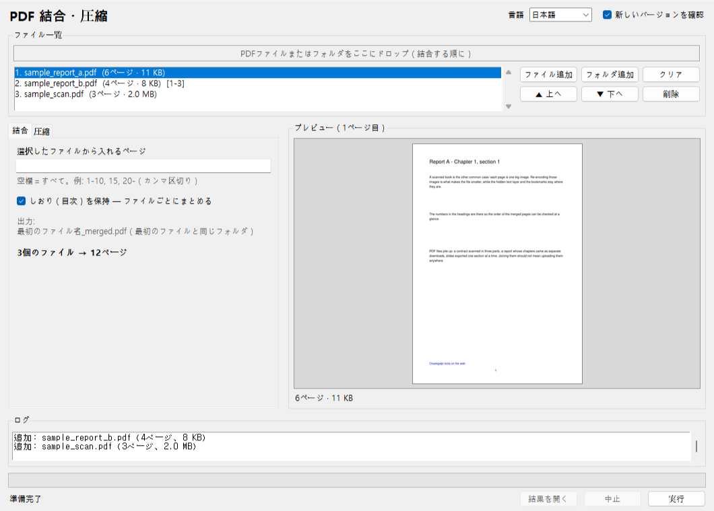
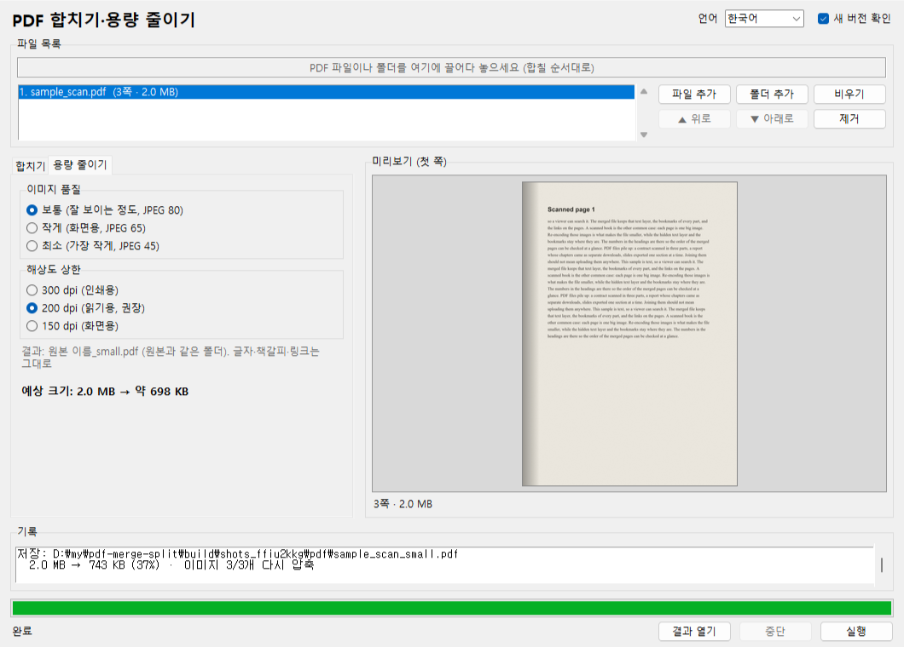
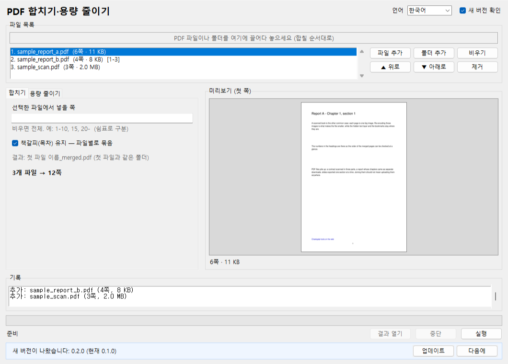

# しおりツール – PDF 結合・圧縮

[한국어](README.md) · [English](README.en.md) · [中文](README.zh-CN.md)

複数の PDF をドロップすると 1 つに**結合**し、画像を再圧縮して**サイズを減らします**。ファイルをどこにもアップロードしない Windows プログラムです。契約書・診療記録・スキャンした本など、他人のサーバーに預けたくない PDF を自分の PC で処理します。サーバーなし（新バージョン確認だけ例外、オフにできます）、インストール不要、ページ数制限なし、元のファイルは変更しません。



## ダウンロード

- **実行ファイル**: [Releases](https://github.com/microhan1/pdf-merge-split/releases) から `pdf-merge-split.exe` を取得してダブルクリック。インストール不要です。署名のない exe のため SmartScreen の警告が出たら「詳細情報 → 実行」を選びます。
- **ソースから実行**:

```bash
pip install -r requirements.txt
python main.py
```

## 使い方

1. PDF ファイルまたはフォルダをウィンドウにドロップします（結合する順に）。一覧でドラッグするか「▲ 上へ」「▼ 下へ」で順序を変えられます。
2. タブを選びます。
   - **結合**: ファイルごとに入れるページを指定できます（`1-10, 15, 20-`）。各ファイルのしおり（目次）はファイル名の項目の下にまとめてそのまま入ります。出力: `最初のファイル名_merged.pdf`。
   - **圧縮**: 画像の品質（普通・小さく・最小）と解像度の上限（300・200・150 dpi）を選ぶと予想サイズが表示されます。画像だけを再圧縮し、文字（検索）・しおり・リンク・ページサイズはそのままです。出力: `元のファイル名_small.pdf`。
3. **実行**を押すと、元のファイルの隣に結果ができます。同名があれば `(2)`、`(3)` を付け、元のファイルは決して変更しません。



*サンプルのスキャン PDF（3 ページ、2.0 MB）を「普通・200 dpi」で圧縮した画面（韓国語表示）。数値はファイルによって異なります。*

コマンドラインでも使えます。

```bash
python main.py a.pdf b.pdf c.pdf --merge
python main.py a.pdf b.pdf --merge --pages 1-10 --pages all
python main.py scan.pdf --shrink --quality small --dpi 150
python main.py scans/ --shrink
```

`python main.py --help` は OS の言語（한국어 · English · 中文 · 日本語）でオプションを表示します。

## サンプルファイル

`samples/` に著作権のないテスト用 PDF があります（`samples/make_sample.py` で生成）。しおりとリンク付きの文字 PDF が 2 つ、300 dpi のスキャン風 PDF が 1 つです。

## 新しいバージョンの確認

起動時に、新しいバージョンがあるか調べるためにツール名（`pdfmerge`）とバージョンだけをしおりサーバー（chaekgalpi.co.kr）に送ります。ファイルは送らず、1 日 1 回だけ確認し、設定でオフにできます（ウィンドウ上部の**新しいバージョンを確認**）。確認はウィンドウが開いた後にバックグラウンドで行い、接続できなければ何も表示しません。コマンドラインで実行したときは確認しません。

新しいバージョンがあるとウィンドウの下に 1 行の通知が出ます。**更新**を押すとしおりツールのページが開き、**後で**を押すとそのバージョンは再通知しません（さらに新しいバージョンが出れば再び通知）。



*ウィンドウ下部の通知行（韓国語表示）。サーバー応答を偽物（新バージョン 0.2.0）にして表示したテスト画面です。*

## しないこと

- 分割（ページ範囲・N ページごと・しおり単位）は次のバージョン（v0.2）で対応予定です。
- OCR、文字の編集、回転・余白のトリミングはしません（余白は [TrimPDF](https://github.com/microhan1/TrimPDF)）。
- パスワード付き PDF は案内してスキップします。パスワードは解除しません。
- 圧縮は画像の再圧縮だけです。文字だけの PDF はほとんど小さくならず、小さくならないファイルは結果を作らず知らせます。1 ビット（FAX 型）の画像と透明マスク付きの画像はそのままにします。
- 新しいバージョンを自動でダウンロード・置き換えしません。

## シリーズ

- しおりツール: [見開き分割](https://github.com/microhan1/scan-pdf-split) · [スキャンPDF補正](https://github.com/microhan1/scan-pdf-cleanup) · [余白トリミング TrimPDF](https://github.com/microhan1/TrimPDF) · [PDF 目次追加](https://github.com/microhan1/pdf-toc-add)
- ブラウザで使うインストール不要版: [見開き分割（Web）](https://microhan1.github.io/spread-split/)
- [しおりライブラリ](https://chaekgalpi.co.kr/en/tools/pdfmerge?utm_source=github&utm_medium=referral&utm_campaign=tool_cta&utm_content=pdfmerge) — 読んだ本と読書記録を残す Web サービス。整理した本を読み終えたら一言残してみてください。

## ライセンス

[GNU Affero General Public License v3.0](LICENSE)。このプログラムは AGPL-3.0 の [PyMuPDF](https://github.com/pymupdf/PyMuPDF) を使うため、同じライセンスで公開します。exe のソースはこのリポジトリで、同梱の構成要素とライセンス全文は [THIRD_PARTY_LICENSES.txt](THIRD_PARTY_LICENSES.txt) にあります。

使用したオープンソース: PyMuPDF (AGPL-3.0)、Pillow (MIT-CMU)、tkinterdnd2 (MIT)、PyInstaller (GPL-2.0 with bootloader exception)
