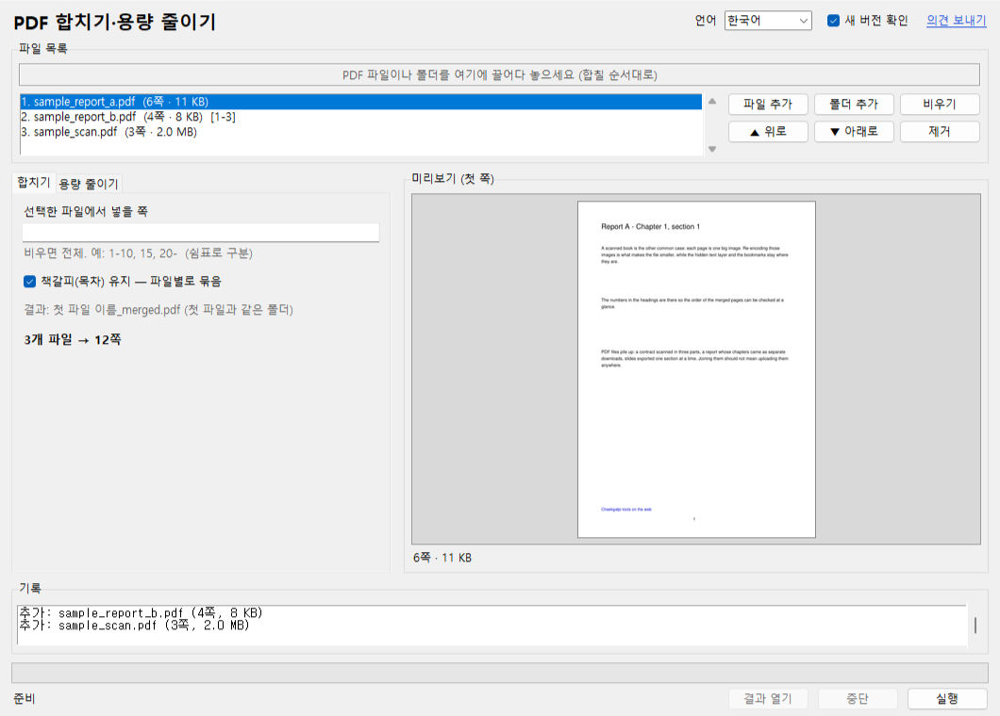

# 책갈피 툴 – PDF 합치기·용량 줄이기

[English](README.en.md) · [中文](README.zh-CN.md) · [日本語](README.ja.md)

PDF 여러 개를 끌어다 놓으면 하나로 **합치고**(pdf 병합), 이미지를 다시 압축해 **용량을 줄입니다**(pdf 압축). 파일을 어디에도 올리지 않는 Windows 프로그램입니다 — 계약서·진료 기록·스캔한 책처럼 남의 서버에 올리기 싫은 PDF를 내 PC에서 처리합니다. 서버 없음(새 버전 확인만 예외, 끌 수 있음), 설치 없음, 쪽수 제한 없음, 원본 무수정.



## 다운로드

- **실행 파일**: [Releases](https://github.com/microhan1/pdf-merge-split/releases)에서 `pdf-merge-split.exe`를 받아 더블클릭. 설치 없이 바로 실행됩니다. 서명하지 않은 exe라 SmartScreen 경고가 뜨면 「추가 정보 → 실행」을 누릅니다.
- **소스 실행**:

```bash
pip install -r requirements.txt
python main.py
```

## 사용법

1. PDF 파일이나 폴더를 창에 끌어다 놓습니다(합칠 순서대로). 목록에서 끌거나 「▲ 위로」「▼ 아래로」로 순서를 바꿉니다.
2. 탭에서 할 일을 고릅니다.
   - **합치기**: 파일마다 넣을 쪽을 지정할 수 있습니다(`1-10, 15, 20-`). 각 파일의 책갈피(목차)는 파일 이름 아래에 묶여 그대로 들어갑니다. 결과는 `첫파일명_merged.pdf`.
   - **용량 줄이기**: 이미지 품질(보통·작게·최소)과 해상도 상한(300·200·150 dpi)을 고르면 예상 크기가 표시됩니다. 글자(검색)·책갈피·링크·쪽 크기는 그대로 두고 이미지만 다시 압축합니다. 결과는 `원본명_small.pdf`.
3. **실행**을 누르면 원본 옆에 결과가 만들어집니다. 같은 이름이 있으면 `(2)`, `(3)`을 붙이고, 원본은 절대 바꾸지 않습니다.


*그림: 샘플 스캔 PDF(3쪽, 2.0 MB)를 「보통·200 dpi」로 줄인 화면. 실제 숫자는 파일에 따라 다릅니다.*

명령줄로도 쓸 수 있습니다.

```bash
python main.py a.pdf b.pdf c.pdf --merge
python main.py a.pdf b.pdf --merge --pages 1-10 --pages all
python main.py scan.pdf --shrink --quality small --dpi 150
python main.py scans/ --shrink
```

`python main.py --help`가 OS 언어(한국어 · English · 中文 · 日本語)로 옵션을 보여줍니다.

## 샘플 파일

`samples/` 폴더에 저작권 없는 시험용 PDF가 있습니다(`samples/make_sample.py`로 만든 것): 글자 PDF 2개(책갈피·링크 포함)와 300 dpi 스캔 모양 PDF 1개. 끌어다 놓고 바로 해 볼 수 있습니다.

## 새 버전 확인

실행할 때 새 버전이 있는지 확인하려고 도구 이름(`pdfmerge`)과 버전만 책갈피 서버(chaekgalpi.co.kr)에 보냅니다. 파일은 보내지 않고, 하루 한 번만 확인하며, 설정에서 끌 수 있습니다(창 위쪽 **새 버전 확인** 체크). 확인은 창이 뜬 뒤 백그라운드에서 하고, 연결이 안 되면 아무것도 표시하지 않습니다. 명령줄로 실행할 때는 확인하지 않습니다.

새 버전이 있으면 창 아래에 한 줄 알림이 나옵니다. **업데이트**를 누르면 책갈피 툴 페이지가 열리고, **다음에**를 누르면 그 버전은 다시 알리지 않습니다(더 새 버전이 나오면 다시 알림).


*그림: 창 아래의 「새 버전이 나왔습니다: 0.2.0 (현재 0.1.1)」 알림 줄. 서버 응답을 가짜(새 버전 0.2.0)로 넣어 띄운 시험 화면입니다.*

## 하지 않는 것

- 나누기(쪽 범위·N쪽마다·북마크 단위)는 다음 버전(v0.2)에 들어갑니다.
- OCR, 글자 수정, 회전·여백 자르기(여백 자르기는 [TrimPDF](https://github.com/microhan1/TrimPDF))는 하지 않습니다.
- 암호가 걸린 PDF는 안내한 뒤 건너뜁니다. 암호를 풀어 주지 않습니다.
- 용량 줄이기는 이미지만 다시 압축합니다. 글자로만 된 PDF는 거의 줄지 않으며, 이미 작은 파일은 결과를 만들지 않고 알립니다. 1비트(팩스식) 이미지와 투명 마스크가 있는 이미지는 그대로 둡니다.
- 새 버전을 자동으로 내려받거나 바꾸지 않습니다.

## 의견 보내기

안 되는 것·불편한 것·바라는 기능은 창 위쪽의 **의견 보내기**를 누르거나 <https://chaekgalpi.co.kr/tools/pdfmerge#feedback> 에서 로그인 없이 보낼 수 있습니다. 브라우저에서 책갈피 툴 페이지가 열릴 뿐, 프로그램이 직접 보내는 것은 없습니다. [GitHub Issues](https://github.com/microhan1/pdf-merge-split/issues)도 그대로 받습니다.

## 시리즈

- 책갈피 툴: [두쪽 나누기](https://github.com/microhan1/scan-pdf-split) · [스캔 PDF 보정](https://github.com/microhan1/scan-pdf-cleanup) · [여백 자르기](https://github.com/microhan1/TrimPDF) · [PDF 목차 넣기](https://github.com/microhan1/pdf-toc-add)
- 설치 없이 브라우저에서 쓰는 웹판: [펼침면 나누기](https://microhan1.github.io/spread-split/)
- [책갈피 라이브러리](https://chaekgalpi.co.kr/tools/pdfmerge?utm_source=github&utm_medium=referral&utm_campaign=tool_cta&utm_content=pdfmerge) — 읽은 책과 독서록을 기록하는 웹 서비스. 정리한 책을 다 읽으면 한 줄 남겨 보세요.

## 라이선스

[GNU Affero General Public License v3.0](LICENSE). 이 프로그램은 AGPL-3.0 라이선스인 [PyMuPDF](https://github.com/pymupdf/PyMuPDF)를 사용하므로 같은 라이선스로 공개합니다. exe의 소스는 이 저장소이고, 포함된 구성 요소와 라이선스 전문은 [THIRD_PARTY_LICENSES.txt](THIRD_PARTY_LICENSES.txt)에 있습니다.

사용한 오픈소스: PyMuPDF (AGPL-3.0), Pillow (MIT-CMU), tkinterdnd2 (MIT), PyInstaller (GPL-2.0 with bootloader exception)
