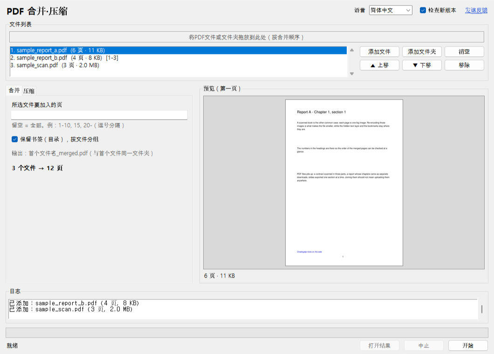

# 书签工具 – PDF 合并·压缩

[한국어](README.md) · [English](README.en.md) · [日本語](README.ja.md)

把多个 PDF 拖进来就能**合并**为一个，或者重新压缩其中的图像来**减小体积**。这是一个不上传任何文件的 Windows 程序：合同、病历、扫描的书籍——凡是不想交给别人服务器的 PDF，都在自己的电脑上处理。无服务器（仅版本检查例外，可关闭）、无需安装、不限页数、原文件不会被修改。



## 下载

- **可执行文件**：在 [Releases](https://github.com/microhan1/pdf-merge-split/releases) 下载 `pdf-merge-split.exe`，双击即可运行，无需安装。exe 未签名，若 SmartScreen 弹出警告，点击"更多信息 → 仍要运行"。
- **从源码运行**：

```bash
pip install -r requirements.txt
python main.py
```

## 用法

1. 把 PDF 文件或文件夹拖到窗口中（按合并顺序）。在列表中拖动，或用"▲ 上移""▼ 下移"调整顺序。
2. 选择标签页。
   - **合并**：每个文件可指定要加入的页（`1-10, 15, 20-`）。各文件的书签（目录）会归在以文件名命名的条目下原样保留。输出：`首个文件名_merged.pdf`。
   - **压缩**：选择图像质量（普通·较小·最小）和分辨率上限（300·200·150 dpi），即显示预计大小。只重新压缩图像，文字（可搜索）、书签、链接、页面尺寸都保持不变。输出：`原文件名_small.pdf`。
3. 点击**开始**，结果写在原文件旁边。若同名文件已存在，则加上 `(2)`、`(3)`；原文件绝不改动。


*示例扫描 PDF（3 页，2.0 MB）以"普通·200 dpi"压缩后的界面（韩文界面）。实际数字因文件而异。*

也可以在命令行使用。

```bash
python main.py a.pdf b.pdf c.pdf --merge
python main.py a.pdf b.pdf --merge --pages 1-10 --pages all
python main.py scan.pdf --shrink --quality small --dpi 150
python main.py scans/ --shrink
```

`python main.py --help` 会按系统语言（한국어 · English · 中文 · 日本語）显示选项。

## 示例文件

`samples/` 中有无版权的测试 PDF（由 `samples/make_sample.py` 生成）：两个带书签和链接的文字 PDF，以及一个 300 dpi 的扫描样式 PDF。

## 检查新版本

启动时，程序只把工具名（`pdfmerge`）和版本号发送到书签服务器（chaekgalpi.co.kr），以了解是否有新版本。不发送任何文件，每天最多检查一次，可在设置中关闭（窗口顶部的**检查新版本**复选框）。检查在窗口打开后于后台进行；无法连接时不显示任何内容。命令行运行时不检查。

有新版本时，窗口底部会出现一行提示。点击**更新**打开书签工具页面；点击**以后**则不再提示该版本（有更新的版本时会再次提示）。


*窗口底部的提示行（韩文界面），使用伪造的服务器应答（新版本 0.2.0）生成的测试画面。*

## 不做的事

- 拆分（页码范围、每 N 页、按书签）计划在 v0.2 加入。
- 不做 OCR、不编辑文字、不旋转、不裁边距（裁边距请用 [TrimPDF](https://github.com/microhan1/TrimPDF)）。
- 加密的 PDF 会提示后跳过，不会解除密码。
- 压缩只重新压缩图像。纯文字 PDF 几乎不会变小；无法变小的文件会提示且不生成结果。1 位（传真式）图像和带透明蒙版的图像保持原样。
- 不会自动下载或替换新版本。

## 反馈

问题或建议可点击窗口顶部的**发送反馈**，或在 <https://chaekgalpi.co.kr/en/tools/pdfmerge#feedback> 提交（英文页面），无需登录。程序只会在浏览器中打开工具页面，本身不发送任何内容。[GitHub Issues](https://github.com/microhan1/pdf-merge-split/issues) 也照常接收。

## 系列

- 书签工具：[双页拆分](https://github.com/microhan1/scan-pdf-split) · [扫描PDF清晰化](https://github.com/microhan1/scan-pdf-cleanup) · [裁边距 TrimPDF](https://github.com/microhan1/TrimPDF) · [PDF 添加目录](https://github.com/microhan1/pdf-toc-add)
- 浏览器中直接使用、无需安装：[跨页拆分](https://microhan1.github.io/spread-split/)
- [书签图书馆](https://chaekgalpi.co.kr/en/tools/pdfmerge?utm_source=github&utm_medium=referral&utm_campaign=tool_cta&utm_content=pdfmerge) —— 记录读过的书和读书笔记的网站。读完整理好的书，留下一句话吧。

## 许可证

[GNU Affero General Public License v3.0](LICENSE)。本程序使用 AGPL-3.0 许可的 [PyMuPDF](https://github.com/pymupdf/PyMuPDF)，因此以相同许可证发布。exe 的源码即本仓库；所含组件及其许可证全文见 [THIRD_PARTY_LICENSES.txt](THIRD_PARTY_LICENSES.txt)。

使用的开源软件：PyMuPDF (AGPL-3.0)、Pillow (MIT-CMU)、tkinterdnd2 (MIT)、PyInstaller (GPL-2.0 with bootloader exception)
